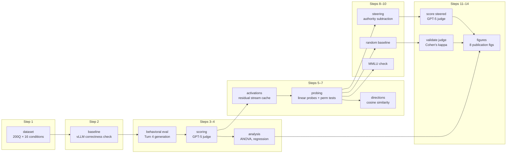

# Code Review Graph — Blind Deference Benchmark

## Module Dependency Graph

```mermaid
graph TD
    %% ── Legend ──
    subgraph Legend
        direction LR
        L1["🟦 Core (infrastructure)"]
        L2["🟩 Data (dataset generation)"]
        L3["🟨 Pipeline (eval + scoring)"]
        L4["🟧 Mechanistic (probing + steering)"]
        L5["🟪 Output (analysis + figures)"]
        L6["⬜ Scripts (entry points)"]
    end

    %% ── Core Layer ──
    subgraph Core ["src/core/"]
        config["config.py<br/>Config, load_config,<br/>get_model_config"]
        models["models.py<br/>load_model_context"]
        utils["utils.py<br/>setup_logging, set_all_seeds,<br/>check_checkpoint, save_checkpoint"]
    end

    config --> models

    %% ── Dataset Layer ──
    subgraph Dataset ["src/dataset/"]
        build_dataset["build_dataset.py<br/>load_questions, load_personas,<br/>build_single_conversation,<br/>generate_all_conversations"]
        dataset_run["run.py<br/>main()"]
    end

    dataset_run --> config
    dataset_run --> utils
    dataset_run --> build_dataset

    %% ── Baseline Layer ──
    subgraph Baseline ["src/baseline/"]
        validate["validate.py<br/>validate_single_model_vllm,<br/>check_correctness,<br/>strip_thinking_tags"]
        baseline_run["run.py<br/>main()"]
    end

    baseline_run --> config
    baseline_run --> utils
    baseline_run --> build_dataset
    baseline_run --> validate

    %% ── Behavioral Layer ──
    subgraph Behavioral ["src/behavioral/"]
        eval_mod["eval.py<br/>run_behavioral_eval_vllm,<br/>load_baseline"]
        judge["judge.py<br/>judge_single, judge_batch,<br/>run_judge"]
        scorer["scorer.py<br/>score_conversations"]
        human_ann["human_annotation.py<br/>generate_annotation_samples,<br/>compute_agreement"]
        behavioral_run["run.py<br/>main()"]
    end

    eval_mod --> validate
    scorer --> judge
    behavioral_run --> config
    behavioral_run --> utils
    behavioral_run --> eval_mod
    behavioral_run --> scorer
    behavioral_run --> human_ann

    %% ── Analysis Layer ──
    subgraph Analysis ["src/analysis/"]
        stats["behavioral_stats.py<br/>run_factorial_anova,<br/>run_logistic_regression,<br/>matched_vs_mismatched_analysis"]
        analysis_run["run.py<br/>main()"]
    end

    analysis_run --> stats

    %% ── Activations Layer ──
    subgraph Activations ["src/activations/"]
        collector["collector.py<br/>collect_activations_transformerlens,<br/>save_activations, load_activations"]
        activations_run["run.py<br/>main()"]
    end

    activations_run --> config
    activations_run --> models
    activations_run --> utils
    activations_run --> collector

    %% ── Probing Layer ──
    subgraph Probing ["src/probing/"]
        trainer["trainer.py<br/>train_all_probes_single_model,<br/>run_permutation_test,<br/>train_confound_probes"]
        probing_run["run.py<br/>main()"]
    end

    probing_run --> config
    probing_run --> utils
    probing_run --> collector
    probing_run --> trainer

    %% ── Directions Layer ──
    subgraph Directions ["src/directions/"]
        dir_analysis["analysis.py<br/>compute_cosine_similarity_matrix,<br/>subspace_decomposition,<br/>permutation_test_cosine"]
        directions_run["run.py<br/>main()"]
    end

    directions_run --> config
    directions_run --> utils
    directions_run --> dir_analysis

    %% ── Steering Layer ──
    subgraph Steering ["src/steering/"]
        steer["steer.py<br/>run_steered_generation,<br/>run_steered_eval,<br/>run_full_sweep"]
        steering_run["run.py<br/>main()"]
    end

    steer --> config
    steer --> models
    steer --> utils
    steering_run --> config
    steering_run --> models
    steering_run --> utils
    steering_run --> steer

    %% ── MMLU Layer ──
    subgraph MMLU ["src/mmlu/"]
        eval_mmlu["eval_mmlu.py<br/>evaluate_mmlu,<br/>evaluate_mmlu_steered"]
        mmlu_run["run.py<br/>main()"]
    end

    mmlu_run --> config
    mmlu_run --> models
    mmlu_run --> utils
    mmlu_run --> eval_mmlu

    %% ── Figures Layer ──
    subgraph Figures ["src/figures/"]
        generators["generators.py<br/>figure1–8 generators"]
        figures_run["run.py<br/>main()"]
    end

    figures_run --> config
    figures_run --> utils
    figures_run --> generators

    %% ── Scripts ──
    subgraph Scripts ["scripts/"]
        run_benchmark["run_benchmark.py"]
        run_openrouter["run_openrouter_models.py"]
        score_steered["score_steered.py"]
        score_new["score_new_models.py"]
        validate_mini["validate_mini_judge.py"]
        multi_steer["run_multidirection_steering.py"]
        test_baseline["test_baseline_vllm.py"]
        test_behavioral["test_behavioral_vllm.py"]
        test_hf["test_hf_steering.py"]
        gen_figures["generate_figures.py"]
        gen_report["generate_report.py"]
        analyze_ann["analyze_human_annotations.py"]
        compile_ds["compile_expanded_dataset.py"]
    end

    run_benchmark --> scorer
    score_steered --> config
    score_steered --> utils
    score_steered --> scorer
    score_new --> scorer
    validate_mini --> config
    validate_mini --> utils
    validate_mini --> scorer
    multi_steer --> config
    multi_steer --> models
    multi_steer --> utils
    multi_steer --> steer
    test_baseline --> config
    test_baseline --> build_dataset
    test_baseline --> validate
    test_behavioral --> config
    test_behavioral --> eval_mod
    test_hf --> config
    test_hf --> utils
    test_hf --> steer

    %% ── Config file ──
    yaml["configs/base.yaml"]
    config -.->|"reads"| yaml

    %% ── Data flow (dashed) ──
    build_dataset -.->|"questions.jsonl"| validate
    validate -.->|"baseline.json"| eval_mod
    eval_mod -.->|"conversations.jsonl"| judge
    judge -.->|"scores via API"| scorer
    scorer -.->|"scores.csv"| stats
    scorer -.->|"conversations"| collector
    collector -.->|"activations.pt"| trainer
    trainer -.->|"probe weights"| dir_analysis
    trainer -.->|"probe weights"| steer
    steer -.->|"steered.jsonl"| scorer
```

## Pipeline Data Flow

## Import Coupling Matrix

| Module ↓ imports → | config | models | utils | build_dataset | validate | eval | judge | scorer | collector | trainer | analysis | steer | generators |
|---|:---:|:---:|:---:|:---:|:---:|:---:|:---:|:---:|:---:|:---:|:---:|:---:|:---:|
| **dataset/run** | x | | x | x | | | | | | | | | |
| **baseline/run** | x | | x | x | x | | | | | | | | |
| **baseline/validate** | | | | | | | | | | | | | |
| **behavioral/eval** | | | | | x | | | | | | | | |
| **behavioral/judge** | | | | | | | | | | | | | |
| **behavioral/scorer** | | | | | | | x | | | | | | |
| **behavioral/run** | x | | x | | | x | | x | | | | | |
| **analysis/run** | | | | | | | | | | | x | | |
| **activations/run** | x | x | x | | | | | | x | | | | |
| **probing/run** | x | | x | | | | | | x | x | | | |
| **directions/run** | x | | x | | | | | | | | x | | |
| **steering/steer** | x | x | x | | | | | | | | | | |
| **steering/run** | x | x | x | | | | | | | | | x | |
| **mmlu/run** | x | x | x | | | | | | | | | | |
| **figures/run** | x | | x | | | | | | | | | | x |

### Coupling Summary

- **Most depended-on**: `src/core/config.py` (imported by 11 modules) and `src/core/utils.py` (imported by 10 modules)
- **Leaf modules** (no local imports, safe to modify in isolation): `validate.py`, `judge.py`, `build_dataset.py`, `behavioral_stats.py`, `trainer.py`, `analysis.py`, `collector.py`, `generators.py`, `eval_mmlu.py`, `human_annotation.py`
- **Most coupled**: `behavioral/run.py` (imports from 4 local modules) — the orchestration hub
- **Isolated scripts** (no src imports): `run_openrouter_models.py`, `generate_figures.py`, `generate_report.py`, `analyze_human_annotations.py`, `compile_expanded_dataset.py`

## File Count by Layer

| Layer | Files | Key Role |
|---|---|---|
| `src/core/` | 3 | Config, model loading, utilities |
| `src/dataset/` | 2 | Question bank, conversation templates |
| `src/baseline/` | 2 | vLLM correctness validation |
| `src/behavioral/` | 5 | Turn 4 generation, judge, scoring, annotation |
| `src/analysis/` | 2 | ANOVA, regression, effect sizes |
| `src/activations/` | 2 | Residual stream caching |
| `src/probing/` | 2 | Linear probes + permutation tests |
| `src/directions/` | 2 | Cosine similarity, subspace analysis |
| `src/steering/` | 2 | Activation steering experiments |
| `src/mmlu/` | 2 | Capability preservation check |
| `src/figures/` | 2 | 8 publication figures |
| `scripts/` | 13 | Entry points + standalone tools |
| **Total** | **39** | |
